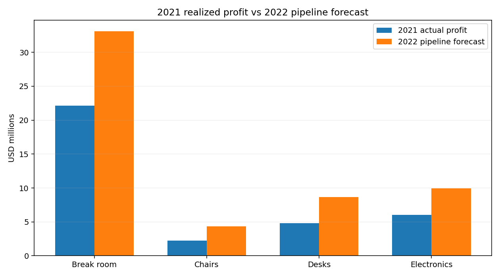
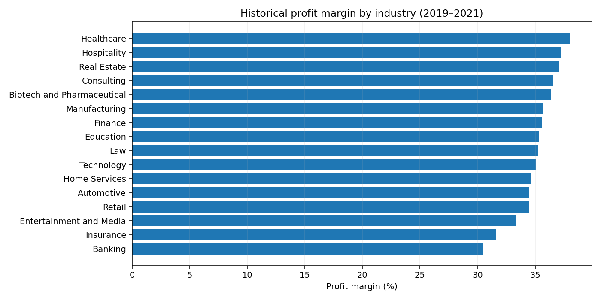

# Smart Desk | SQL Business Performance Analysis

**Snowflake SQL · Sales Analytics · Profitability · Forecast Analysis**

A portfolio case study adapted and independently reviewed from a Data Science & Big Data Analytics master's assignment. Smart Desk is the fictional business scenario supplied in the coursework. The goal is to use relational data to evaluate sales performance, regional differences, industry profitability, and the commercial pipeline.

> **Data and reproducibility:** The three authorized coursework CSV datasets are included under `data/`. `Accounts.csv` has been minimized by removing contact email addresses and account executive names. Aggregate results and charts were independently recalculated. The revised SQL has **not** yet been executed against a live Snowflake instance.

## Business questions

1. Which product categories generated the most revenue and profit for a selected customer in 2020?
2. How do average revenue, units and profit per sales record differ across APAC and EMEA countries?
3. Which industries generate the most historical profit among accounts with a *Commit*-stage forecast exceeding $500,000?
4. How do **realized 2021 profits** compare with **2022 pipeline forecasts** by category?

An additional exploratory study examines whether high sales volume necessarily corresponds to higher profit margins.

## Key findings

- The data contain **159 sales records for 100 distinct accounts** across 2019–2021. A sales record is **not verified to be a unique customer order**.
- **Retail** has the highest historical revenue among the industries represented in `SALES` (**$36.06M**), while **Healthcare** has the highest aggregate profit margin (**38.03%**). Higher revenue does not necessarily imply a higher margin.
- **Automotive** has the highest mean profit per sales record (approximately **$769,853**), but that metric should not be interpreted as profit per order without an order identifier.
- **Break room** has the largest realized 2021 profit (**$22.12M**) and the largest 2022 pipeline forecast (**$33.11M**).
- **Chairs** shows the largest relative forecast-to-prior-year-profit difference (**+96.19%**). This is **not** evidence that realized profit grew by that amount: a forecast and an actual are different measures.





## Method

- Joined `SALES` with `ACCOUNTS` on `ACCOUNT` to study industry and geography.
- Filtered eligible accounts using an `IN` subquery with `GROUP BY` and `HAVING` against `FORECASTS`.
- Computed aggregate revenue, profit, margin and descriptive statistics using SQL.
- Aggregated 2021 actuals and 2022 forecasts **separately** before using `FULL OUTER JOIN` by category, preventing row multiplication and incorrect year matching.
- Used **weighted aggregate profit margin**: `SUM(PROFIT) / SUM(TOTAL)`, rather than averaging individual margins.

## Repository layout

```text
smart-desk-sql-business-analysis/
├── README.md
├── data/
│   ├── Sales.csv
│   ├── Accounts.csv          # contact fields removed
│   └── Forecasts.csv
├── sql/
│   ├── 01_business_questions.sql
│   └── 02_exploratory_analysis.sql
├── results/
│   ├── actual_vs_forecast.png
│   ├── industry_margins.png
│   └── *.csv                     # Aggregate outputs only
└── docs/
    ├── findings.md
    └── data_access.md
```

## How to run

1. Load the three CSVs in `data/` into your authorized Snowflake schema as `SALES`, `ACCOUNTS` and `FORECASTS`.
2. Select the appropriate Snowflake role, warehouse, database and schema for **your** environment. Do not copy course-specific credentials or warehouse names.
3. Run the statements in [`sql/01_business_questions.sql`](sql/01_business_questions.sql), then [`sql/02_exploratory_analysis.sql`](sql/02_exploratory_analysis.sql).
4. Compare outputs with the aggregate files under `results/`. Small presentation differences may occur due to rounding.

**SQL dialect:** Snowflake SQL. No secret credentials, connection strings, or personal email addresses are included.

## Limitations

- The dataset is small and represents a course case study, not a live business.
- The `SALES` table lacks a unique order identifier, so results are described as **sales records**, not orders.
- `FORECAST` is a pipeline value, not confirmed future realized profit. Relative differences between forecast and historical profit are directional only.
- Industry/country comparisons can be affected by different sample sizes, account mix and sales-record frequency; no causal conclusions are established.
- Revenue from `SUPPORT` does not, by itself, measure incident rates or service quality.

For the full interpretation and suggested next analyses, see [Findings and recommendations](docs/findings.md).

## Origin and authorship

Adapted from an individual SQL assignment completed as part of a master's program. The original work was revised for clarity, technical correctness, and reproducibility. Charts and validated aggregate outputs were regenerated from the supplied CSVs.
